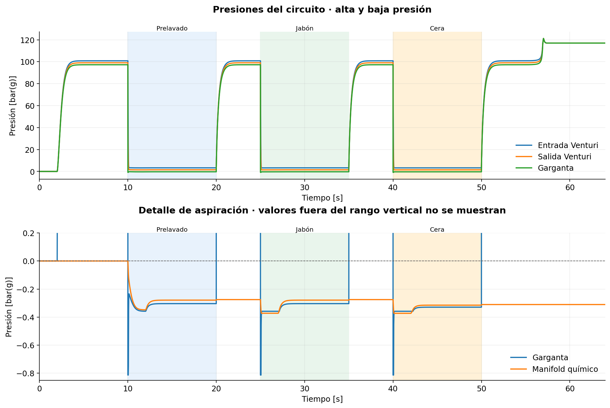
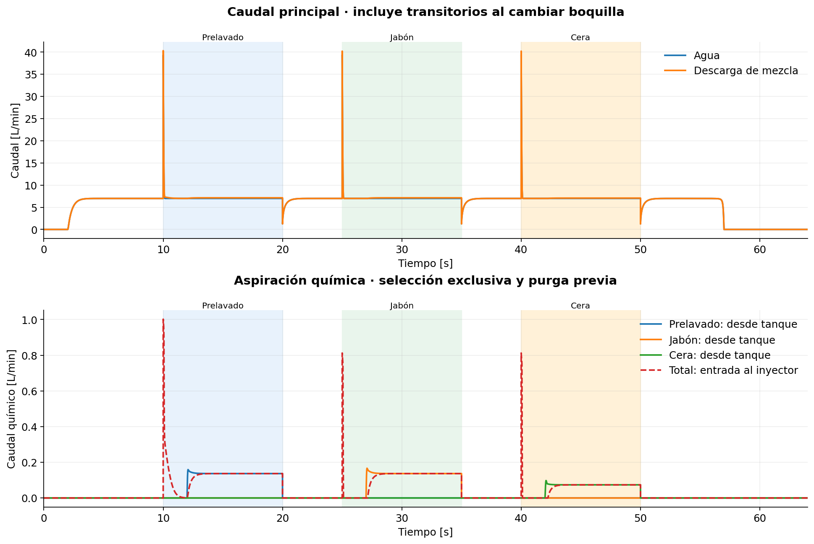
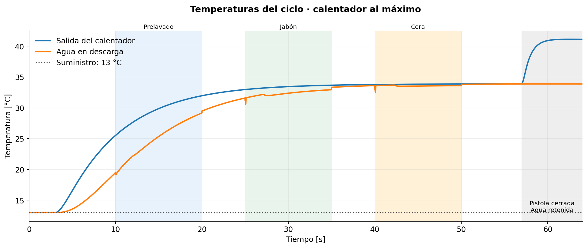

# Autolavado en Modelica

Modelo hidráulico y térmico de un autolavado con calentador externo HACEB, hidrolavadora TRENT, inyector downstream y boquillas de alta y baja presión.

## Circuito actual

```text
Agua a 13 °C → HACEB → TRENT → acumulador y alivio → Venturi
             → manguera de 8 m → pistola → boquilla → ambiente

Tanque con respiradero → sifón → electroválvula NC → check → aguja
                     → manifold común → antirretorno del inyector
```

Las tres ramas químicas alimentan prelavado, jabón y cera. Sus electroválvulas son normalmente cerradas, con alimentación prevista de 12 VDC. Se selecciona un producto a la vez y se purga durante 2 s con agua circulando antes de abrir su electroválvula.

| Elemento | Configuración del modelo |
|---|---|
| Agua de entrada | 13 °C; frontera a 101325 Pa absolutos |
| Calentador | HACEB de paso a gas natural; 8 L/min declarados; ajuste manual al máximo |
| Potencia de calentamiento | 12 kW interpretados como entrada de gas; eficiencia supuesta de 0,85 |
| Hidrolavadora | TRENT HLT395-1800 equivalente: 1800 W, límite de 7 L/min y 130 bar declarados |
| Inyector de referencia | General Pump 100819; equivalente hidráulico pendiente de calibración |
| Enjuague | Boquilla de alta presión de 1,15 mm |
| Prelavado, jabón y cera | Boquilla de baja presión de 4,6 mm; diámetro provisional de diseño |
| Coeficiente de descarga | Cd = 0,8 supuesto para ambas boquillas |
| Manguera de alta presión | 8 m; diámetro interior supuesto de 8 mm |
| Sifones | Diámetro interior de 12,7 mm; longitud de 2 m y elevación inicial de 0,5 m supuestas |

La selección ideal de boquilla por programa representa que el operador coloca la boquilla correspondiente. El gatillo cierra la pistola independientemente. La boquilla de baja se selecciona durante la purga; la aspiración resulta de las presiones y resistencias, sin imponer el caudal químico.

El calentador usa `gasSetting=1` y `automaticTemperatureControl=false`. La temperatura resulta del caudal, la inercia térmica y el balance de energía. La curva equivalente de la bomba tiene límites de caudal y potencia: los 130 bar y 7 L/min no se imponen simultáneamente.

## Resultados actuales

Ciclo `autolavado.SelfServiceCarWashTest`, de 0 a 64 s, Modelica 4.1.0, DASSL y tolerancia de 1e-6.

| Etapa | Instante | Boquilla | Aspiración química | Presión de garganta |
|---|---:|---:|---:|---:|
| Prelavado | 18 s | 4,6 mm | 0,1369 L/min | −0,3040 bar(g) |
| Jabón | 33 s | 4,6 mm | 0,1369 L/min | −0,3040 bar(g) |
| Cera | 48 s | 4,6 mm | 0,0738 L/min | −0,3293 bar(g) |

En enjuague no hay aspiración química. La validación comprueba conservación de masa y energía, selección de boquilla, exclusividad de electroválvulas, aspiración en las tres etapas y ausencia de descarga con la pistola cerrada. El registro con la identidad del modelo está en [current-validation.json](verification/results/current-validation.json).

Estos valores son simulados. El diámetro de baja, Cd, curva de bomba y coeficientes hidráulicos del Venturi y las válvulas son supuestos ajustables; no constituyen curvas comerciales calibradas ni dosis garantizadas. El límite de presión de garganta puede actuar durante cambios de boquilla: esos transitorios requieren un modelo adicional para estudiar cavitación o golpe de ariete.

## Gráficas del ciclo actual

Generadas directamente del CSV de la simulación actual de dos boquillas. Las franjas indican las etapas químicas; cada etapa empieza con la purga previa a abrir su electroválvula. Son resultados simulados con los supuestos de diseño descritos arriba.

### Presiones y vacío de aspiración



La vista inferior amplía las presiones de aspiración; las presiones altas quedan fuera de ese rango vertical. Una presión manométrica negativa indica presión inferior a la atmosférica.

### Caudales de agua y químicos



Se distingue la extracción desde cada tanque del caudal que entra al inyector. Pueden diferir durante los transitorios por el líquido almacenado en las ramas y el manifold.

### Temperaturas



Desde los 57 s la pistola está cerrada. Las temperaturas en ese tramo corresponden al agua retenida, sin entrega continua al exterior.

Para regenerar solo las gráficas después de simular y validar:

```powershell
py -3 verification/plot_current.py
```

## Abrir y ejecutar

1. Instalar OpenModelica con Modelica 4.1.0 y Python 3.
2. Abrir `autolavado.mo` en OMEdit.
3. Seleccionar `autolavado.SelfServiceCarWashTest` y simular.
4. Abrir `plant` para inspeccionar los equipos.

Para ejecutar simulación, validación y generación del Excel y las gráficas desde PowerShell, en la raíz del proyecto:

```powershell
py -3 -m pip install -r requirements.txt
powershell -NoProfile -ExecutionPolicy Bypass -File verification/run_current.ps1
```

El script busca `omc` en PATH o bajo Program Files. Si hace falta, especificar los ejecutables:

```powershell
powershell -NoProfile -ExecutionPolicy Bypass -File verification/run_current.ps1 -Compiler 'C:\ruta\OpenModelica\bin\omc.exe' -Python 'C:\ruta\python.exe'
```

El comando se detiene si falla la simulación, si no hay un CSV nuevo, si falla la validación o si falla la generación del Excel. La compilación y los resultados brutos quedan en `verification/current/`, excluido de Git. El informe de validación actual sí se versiona.

## Archivos principales

| Archivo | Contenido |
|---|---|
| [autolavado.mo](autolavado.mo) | Componentes, control y experimentos Modelica |
| [CALENTADOR.md](CALENTADOR.md) | Balance térmico, ajuste manual y parámetros HACEB |
| [INYECCION.md](INYECCION.md) | Circuito químico y referencia downstream |
| [Memoria original](Memoria_Calculo_Hidraulica_Autolavado.xlsx) | Datos y plantilla suministrada |
| [Informe Modelica](Memoria_Calculo_Hidraulica_Modelica.xlsx) | Resultados por equipo, sin comparaciones ni fórmulas de Excel |
| [current_memory.mos](verification/current_memory.mos) | Simulación del ciclo actual |
| [validate_current.py](verification/validate_current.py) | Comprobaciones de la configuración actual |
| [report_current.py](verification/report_current.py) | Generador del Excel con estilos compatibles |
| [run_current.ps1](verification/run_current.ps1) | Ejecución completa desde PowerShell |

El Excel distingue resultados simulados y parámetros. El calentador incluye el final a 64 s, con agua retenida y caudal nulo, y el valor a 55 s antes del cierre con agua circulando. Si Excel tiene abierto el informe, se guarda una copia con sufijo `_nuevo`.

Los scripts `injection.mos`, `haceb.mos`, `verify.ps1` y sus validadores se conservan como herramientas anteriores; sus expectativas y reportes históricos no validan automáticamente la configuración de dos boquillas. El punto de entrada actual es `run_current.ps1`.

## Variables para inspeccionar

- `plant.gun.activeNozzleDiameter`: diámetro seleccionado.
- `plant.waterFlow_L_min`, `plant.outletFlow_L_min`: caudales de agua y descarga.
- `plant.injector.mChemical`: caudal másico aspirado, en kg/s.
- `plant.productFlow_L_min`: entrega de cada rama al manifold.
- `plant.throatPressure`, `plant.chemicalManifoldPressure`: presiones absolutas.
- `plant.chemicalInjectionBlocked`: electroválvula abierta sin diferencial para aspirar.
- `plant.inletHeater.T`, `plant.outletTemperature`: temperaturas, en K.
- `plant.pumpPressure_bar`: presión manométrica de descarga de bomba.

El medio es agua de propiedades constantes, también en las ramas químicas. Las formulaciones reales, compatibilidad de materiales, resistencia mecánica de componentes y comportamiento térmico de la hidrolavadora deben confirmarse con datos físicos. No se modelan espuma, combustión detallada ni pulsaciones de pistones.
